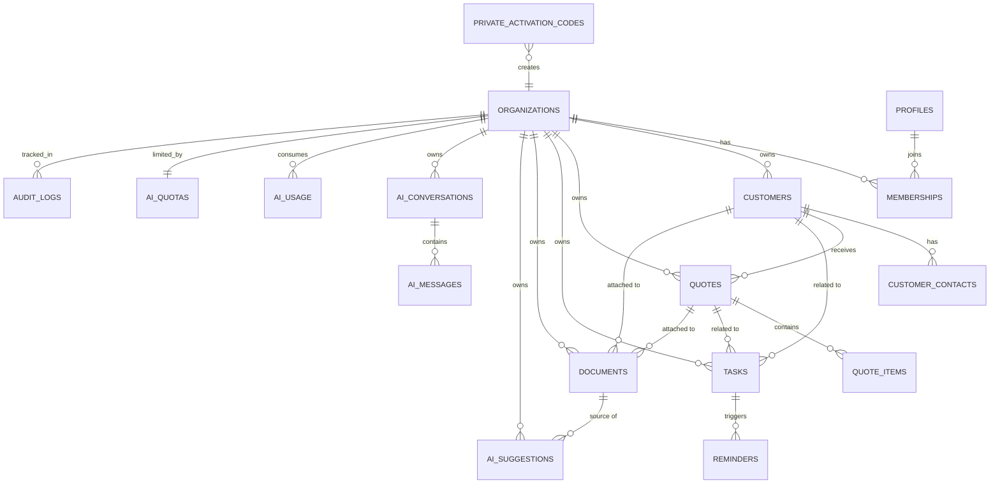

# NEXORA 2.0 – Documento di architettura tecnica

Stato: **BOZZA PER APPROVAZIONE** · Data: 2026-11-19
Nessun codice scritto, nessun database creato, nessun progetto Vercel/Supabase creato. NEXORA 1 non è stata toccata.

---

## 0. Premesse e decisioni che propongo di modificare

### 0.1 Limiti di questa bozza
- Il primo messaggio era troncato alla sezione 3 ("Creazione, modifica e gestione dei…"). L'elenco funzionale completo non l'ho visto: ho assunto i domini indicati nel secondo messaggio.
- **Non ho ancora analizzato il codice di NEXORA 1.** Prima di chiudere il perimetro funzionale serve un inventario di v1 (pagine, tabelle, funzioni) per garantire che nessuna funzionalità vada persa. È la prima azione proposta in Fase 0.

### 0.2 Modifiche e precisazioni proposte (richiedono la tua approvazione)

| # | Decisione di partenza | Proposta | Motivo |
|---|---|---|---|
| M1 | Versioni "stabili" | Next 16.x, React 19.x, Tailwind 4.x, Zod 4.x: ok. **TypeScript: NON 7.x** (appena uscito, compilatore nativo): usare l'ultima 5.x/6.x stabile finché Next, typescript-eslint e Vitest non lo supportano ufficialmente. Stessa cautela per ESLint 10 (verificare `eslint-config-next`). | Evitare toolchain rotta a inizio progetto. Verifica compatibilità in Fase 0, versioni bloccate nel lockfile. |
| M2 | "Amministrazione" | Dividere in **Admin organizzazione** (utenti, ruoli, impostazioni, consumi AI della propria azienda) e **Console piattaforma** (codici di attivazione, tutte le aziende, quote AI). | Sono due livelli di privilegio molto diversi; la console piattaforma usa il service role solo lato server e richiede MFA. Da te serve conferma su chi gestirà la console. |
| M3 | Codice di attivazione | Il codice è **monouso, scadente, salvato come hash** e opzionalmente **legato all'email** dell'invitato. Registrazione pubblica disabilitata in Supabase Auth; l'utente è creato dal server (Admin API). | Un codice generico condivisibile è un punto debole; legarlo all'email dà anche la verifica di proprietà dell'email. |
| M4 | Schema `private` | Confermato. Aggiungo: le funzioni helper delle policy RLS (`private.is_member`, `private.has_role`) sono `SECURITY DEFINER` con `search_path` fisso; lo schema `private` **non** è in "Exposed schemas" della Data API. Nessuna scrittura privilegiata dal client. | Evita ricorsione RLS e esposizione accidentale. |
| M5 | Ambienti | Locale (Supabase CLI/Docker) + **staging** (progetto Supabase cloud) + **produzione** (progetto cloud separato, piano Pro per backup/PITR). Niente "dev cloud" separato. | Riduce costi e deriva di configurazione. Se vuoi un dev cloud condiviso, si aggiunge. |
| M6 | AI "senza modifiche autonome" | Il modello **non ha mai tool di scrittura**. Produce solo `ai_suggestions` (proposte strutturate). L'applicazione avviene con una Server Action richiamata dall'utente, con i suoi permessi RLS. | Difesa contro prompt injection (es. testo malevolo in un PDF). |
| M7 | Accesso ai dati | `supabase-js` con la sessione utente (RLS attiva) + tipi generati. **Nessun ORM** (Prisma/Drizzle esclusi). Migrazioni SQL pure. | Un ORM con connessione diretta aggirerebbe RLS; SQL puro è coerente con il requisito di migrazioni versionate. |
| M8 | Regione e GDPR | Progetti Supabase in **UE (Francoforte)**; DPA con Supabase, Vercel (regione `fra1`) e Anthropic; log AI senza dati personali non necessari; funzione di esportazione/cancellazione dati per organizzazione. | Target PMI italiane: GDPR è requisito, non optional. |
| M9 | Preventivi | Importi in **interi (centesimi)** + aliquota IVA per riga; numerazione progressiva per organizzazione e anno **senza buchi**, generata in DB. Fatturazione elettronica (SDI) **fuori perimetro** salvo tua richiesta. | Correttezza fiscale/contabile; evita errori di arrotondamento. |
| M10 | Astrazione AI | Interfaccia propria sottile (`AiProvider`) invece del Vercel AI SDK. | Meno dipendenze, controllo su quote, log e PDF; Claude come primo adapter. |

---

## 1. Architettura tecnica

### 1.1 Principi
1. **Monolite modulare**: un'unica app Next.js, un modulo per dominio, dipendenze tra moduli solo tramite le loro API pubbliche (`index.ts`).
2. **Strati separati per modulo**: `ui` → `actions` (Server Actions/route handler, autorizzazione) → `service` (logica applicativa) → `repository` (accesso dati) ; `schemas` (Zod) condivisi. Dipendenze solo verso il basso.
3. **Sicurezza in profondità**: RLS (garanzia finale) + controllo permessi applicativo + validazione input + audit.
4. **Il server decide**: operazioni privilegiate solo in codice `server-only`; il service role non raggiunge mai il browser né i moduli UI.

### 1.2 Moduli (domini)
Dashboard · Clienti · Preventivi · Attività (incl. promemoria) · Documenti · Copilot AI · Organizzazioni (membri, ruoli, impostazioni) · Amministrazione (console piattaforma). Più moduli trasversali: `auth`, `audit`, `shared`.

### 1.3 Flusso di una richiesta
```
Browser → Server Component / Server Action
  → auth: getSession() + risoluzione organizzazione attiva + ruolo
  → schemas: validazione Zod dell'input
  → service: regole di business (può chiamare altri moduli solo via API pubblica)
  → repository: query supabase-js con client "utente" (RLS applicata)
  → audit: scrittura audit_log per le mutazioni
```
Il client service-role è disponibile solo in `src/server/supabase/admin.ts` (con `import "server-only"`) e solo i moduli `auth/activation`, `admin` e `audit` possono importarlo (regola ESLint `no-restricted-imports`).

### 1.4 Organizzazione attiva
Un utente può appartenere a più organizzazioni. L'organizzazione attiva è in un cookie firmato; **non è mai fidata**: a ogni richiesta si verifica la membership e RLS verifica comunque `organization_id`.

---

## 2. Schema ER del database

Schemi: `public` (tabelle applicative, tutte con RLS) · `private` (funzioni, codici di attivazione, admin di piattaforma, contatori; non esposto alla Data API).



### 2.1 Tabelle (colonne principali)
Tutte le tabelle di `public` hanno: `id uuid pk default gen_random_uuid()`, `organization_id uuid not null → organizations`, `created_at`, `updated_at`, `created_by`, e (dove sensato) `deleted_at` per soft delete.

| Tabella | Contenuto essenziale |
|---|---|
| `organizations` | `name`, `slug`, `vat_number`, `settings jsonb`, `status` (active/suspended) |
| `profiles` | `id` = `auth.users.id`, `full_name`, `locale`, `default_organization_id` |
| `memberships` | `organization_id`, `user_id`, `role` (owner/admin/member/viewer), unique(org, user) |
| `customers` | ragione sociale, P.IVA, CF, indirizzo, email, telefono, stato, note, tag |
| `customer_contacts` | `customer_id`, nome, ruolo, email, telefono |
| `quotes` | `customer_id`, `number` (per org/anno), `status` (draft/sent/accepted/rejected/expired), `issue_date`, `valid_until`, totali in centesimi, note, termini |
| `quote_items` | `quote_id`, posizione, descrizione, quantità, prezzo unitario (cent), sconto, aliquota IVA |
| `tasks` | titolo, descrizione, stato, priorità, scadenza, assegnatario, `customer_id?`, `quote_id?` |
| `reminders` | `task_id`, `remind_at`, canale, stato invio |
| `documents` | metadati file, `storage_path`, mime, size, `customer_id?`, `quote_id?`, stato analisi |
| `ai_suggestions` | `kind`, `payload jsonb` (validato Zod), `source` (document/conversation), `status` (pending/accepted/rejected), `decided_by` |
| `ai_conversations` / `ai_messages` | cronologia Copilot per utente/organizzazione |
| `ai_usage` | `user_id`, feature, provider, modello, token in/out, costo stimato, timestamp |
| `ai_quotas` | `organization_id` pk, limite mensile token/costo, periodo corrente |
| `audit_logs` | `actor_id`, azione, entità, `entity_id`, diff/metadati, IP; **append-only** (nessun update/delete per nessun ruolo) |
| `private.activation_codes` | `code_hash`, `expires_at`, `max_uses`, `used_count`, `bound_email?`, `plan`, `created_by_platform_admin` |
| `private.platform_admins` | `user_id` |
| `private.quote_counters` | `(organization_id, year)` → ultimo numero |

Indici: `(organization_id, …)` come prefisso su tutti gli indici di ricerca; indici su colonne usate nelle policy.

### 2.2 Storage
Bucket privato `documents`, percorso `{organization_id}/{document_id}/{filename}`. Policy su `storage.objects` che estraggono l'`organization_id` dal percorso e verificano la membership. Download tramite signed URL a breve scadenza generati dal server. Limiti di dimensione e mime-type per bucket.

---

## 3. Struttura definitiva delle cartelle

```
nexora-2/
├─ .github/workflows/        ci.yml · e2e.yml · db-check.yml · deploy-prod.yml
├─ docs/                     architettura, ADR (decisioni), runbook, modello permessi
├─ supabase/
│  ├─ config.toml
│  ├─ migrations/            SQL versionato (YYYYMMDDHHMMSS_nome.sql)
│  ├─ tests/                 pgTAP: RLS, isolamento tenant, funzioni
│  └─ seed.sql               solo dati di sviluppo
├─ e2e/                      Playwright (+ fixtures multi-tenant)
├─ public/
├─ src/
│  ├─ app/                   solo routing e composizione
│  │  ├─ (public)/           login, attivazione, reset password
│  │  ├─ (app)/              area autenticata
│  │  │  ├─ dashboard/ clienti/ preventivi/ attivita/
│  │  │  ├─ documenti/ copilot/ organizzazione/
│  │  ├─ (platform)/admin/   console piattaforma
│  │  ├─ api/                webhook, cron, streaming AI
│  │  └─ proxy.ts            (middleware) refresh sessione
│  ├─ modules/
│  │  ├─ dashboard/ clienti/ preventivi/ attivita/ documenti/
│  │  ├─ copilot/ organizzazioni/ amministrazione/
│  │  └─ <modulo>/ { ui/ · actions/ · service/ · repository/ · schemas/ · types.ts · index.ts }
│  ├─ server/                codice server-only trasversale
│  │  ├─ supabase/           client.ts (browser) · server.ts (SSR) · admin.ts (service role)
│  │  ├─ auth/               sessione, org attiva, guard, permessi (RBAC)
│  │  ├─ ai/                 provider.ts · providers/anthropic.ts · prompts/ · quota.ts · usage.ts
│  │  ├─ audit/ · rate-limit/ · errors/ · env.ts (validazione Zod)
│  ├─ components/ui/         shadcn/ui
│  ├─ components/            componenti condivisi
│  ├─ lib/                   utilità pure (money, date, format it-IT)
│  └─ types/database.ts      tipi generati da Supabase
├─ tests/                    unit/integration Vitest
├─ .env.example · eslint.config.mjs · vitest.config.ts · playwright.config.ts
└─ package.json · package-lock.json   (versioni esatte)
```
Gestore pacchetti: **npm** (lockfile unico, versione di Node fissata in `.nvmrc` ed `engines`).
Regole imposte da lint: i `modules/*` non importano da `app/`; `ui` non importa da `repository`; solo `server/` e `actions/` toccano il client Supabase; nessun accesso a `admin.ts` fuori dai moduli autorizzati.

---

## 4. Autenticazione e attivazione

### 4.1 Configurazione Auth
- Registrazione pubblica **disabilitata**; provider email+password (MFA TOTP obbligatoria per la console piattaforma e consigliata per owner/admin).
- Sessioni via `@supabase/ssr` (cookie httpOnly, refresh in `proxy.ts`). Lato server si usa sempre la verifica del token (`getClaims`/`getUser`), mai il solo contenuto del cookie.
- Password policy, protezione password compromesse, rate limit Auth attivi.

### 4.2 Flusso di attivazione di una nuova azienda
1. L'amministratore di piattaforma genera un codice (console): `private.activation_codes` salva solo l'**hash**; il codice in chiaro è mostrato una volta e inviato all'azienda (opz. legato a un'email).
2. L'azienda apre `/attivazione` e inserisce codice, email, nome azienda, nome utente, password.
3. Server Action: rate limit per IP/email → validazione Zod → RPC `private.redeem_activation_code(...)` che, **in una sola transazione**, verifica hash/scadenza/usi/email, incrementa l'uso (lock di riga), crea `organization`, `ai_quotas` iniziale e `membership` owner.
4. Il server crea l'utente con Admin API (`email_confirm` vero solo se il codice è legato all'email; altrimenti invio email di verifica prima dell'attivazione dell'accesso) e collega `profiles`.
5. Se un passo fallisce, compensazione (eliminazione utente/org creati) e codice non consumato; tutto in audit log.
6. Login e redirect alla dashboard con l'organizzazione attiva.

### 4.3 Altri utenti dell'azienda
Owner/admin invitano per email (invito con token a scadenza) → l'utente imposta la password → membership con ruolo assegnato. Nessun accesso senza invito.

### 4.4 Login e ruoli
`owner` (tutto, incl. fatturazione/eliminazione org) · `admin` (gestione utenti e dati) · `member` (CRUD sui dati operativi) · `viewer` (sola lettura). Permessi definiti in una matrice unica (`server/auth/permissions.ts`) e replicati nelle policy RLS (scrittura vietata a viewer, gestione membership solo owner/admin). Cambio ruolo/rimozione sono auditati; ultimo owner non rimovibile.

---

## 5. Sicurezza e isolamento multi-tenant

1. **RLS attiva su ogni tabella `public`** e su `storage.objects`; default-deny; nessuna policy `to anon` sui dati aziendali.
2. Policy standard: `using (private.is_member(organization_id))`; scritture con `private.has_role(organization_id, array['owner','admin','member'])`; `with check` sempre presente per impedire di inserire/spostare righe in un'altra organizzazione. `organization_id` immutabile (trigger).
3. Chiavi composte/FK che includono `organization_id` dove un figlio referenzia un padre (es. `quote_items` → `quotes`), per impedire riferimenti cross-tenant.
4. Funzioni `SECURITY DEFINER` solo in `private`, `search_path` vuoto/fisso, `execute` revocato a `public` e concesso solo ai ruoli necessari.
5. **Service role** mai esposto al client (nessun `NEXT_PUBLIC_`), usato solo in poche funzioni server tracciate.
6. Validazione Zod di ogni input; Server Actions con autorizzazione esplicita (le Server Actions sono endpoint pubblici); protezione CSRF di Next + controllo `Origin`.
7. Header di sicurezza (CSP con nonce, HSTS, X-Content-Type-Options, frame-ancestors), cookie `Secure/HttpOnly/SameSite`.
8. Rate limiting su login, attivazione, endpoint AI (basato su Postgres o Upstash; da decidere in Fase 0).
9. Upload: controllo mime e dimensione, bucket privato, signed URL brevi, scansione antivirus opzionale (criticità C5).
10. AI: nessun tool di scrittura; contenuti dei PDF trattati come dati non attendibili; output validato con schema; quote e limiti per organizzazione.
11. Audit log append-only per mutazioni sensibili e accessi amministrativi.
12. Segreti solo in variabili d'ambiente Vercel/GitHub, separate per ambiente; scansione segreti e `npm audit`/Dependabot in CI.
13. Verifiche automatiche: advisor di sicurezza Supabase, test pgTAP "tenant A non vede/modifica tenant B" su **ogni** tabella (test generato dall'elenco tabelle, che fallisce se una tabella non ha RLS).

---

## 6. Strategia di test e deploy

### 6.1 Test
| Livello | Strumento | Cosa |
|---|---|---|
| Unit | Vitest | calcoli preventivi, permessi, schemi Zod, provider AI (mock) |
| Integrazione | Vitest + Supabase locale | repository/service con DB reale |
| Database/RLS | pgTAP (`supabase test db`) | isolamento tenant, ruoli, funzioni private, storage |
| E2E | Playwright | attivazione, login, CRUD, preventivo end-to-end, isolamento con due aziende, Copilot con AI simulata |
| Qualità | ESLint, `tsc --noEmit`, `next build`, Prettier | a ogni PR |
| Sicurezza | advisor Supabase, `npm audit`, secret scan | a ogni PR / settimanale |

Le chiamate reali ad Anthropic non sono nei test automatici (provider simulato); un piccolo set di test "smoke" manuale/programmato in staging.

### 6.2 Ambienti e pipeline
- **Locale**: Supabase CLI + `supabase db reset` (migrazioni + seed).
- **PR**: GitHub Actions → lint, typecheck, unit, DB test su stack locale, build, E2E; Vercel Preview collegata al progetto Supabase **staging** (o a un branch Supabase).
- **Staging** (`main`): migrazioni applicate automaticamente, E2E di fumo post-deploy.
- **Produzione**: promozione manuale (tag/approvazione), migrazioni applicate prima del deploy con approvazione, backup/PITR attivo, rollback via Vercel + migrazioni correttive (approccio expand/contract, niente migrazioni distruttive in un solo passo).
- Branch protection su `main`, review obbligatoria, commit convenzionali.
- Il nuovo progetto usa repository, progetto Supabase e progetto Vercel **nuovi**; nessuna variabile o chiave condivisa con NEXORA 1.

---

## 7. Dipendenze e motivazioni
Versioni verificate su npm il 2026-11-19; saranno **bloccate esattamente** nel lockfile dopo la verifica di compatibilità in Fase 0 e la lettura della documentazione ufficiale.

| Pacchetto | Ver. attuale | Motivo |
|---|---|---|
| next | 16.4.x | Framework App Router (nota: in v16 il middleware si chiama `proxy.ts`) |
| react / react-dom | 19.3.x | Richiesto da Next |
| typescript | **5.x/6.x stabile (non 7)** | Vedi M1 |
| tailwindcss | 4.3.x | Stile; configurazione CSS-first |
| shadcn/ui (+ radix-ui, class-variance-authority, clsx, tailwind-merge, lucide-react) | – | Componenti copiati nel repo, accessibili |
| @supabase/supabase-js | 2.119.x | Client DB/Auth/Storage |
| @supabase/ssr | 0.12.x | Sessione via cookie in SSR |
| @anthropic-ai/sdk | 1.10.x | Provider AI Claude (incl. input PDF) |
| zod | 4.6.x | Validazione input/output (anche output AI) |
| react-hook-form + @hookform/resolvers | 7.92.x | Form complessi (righe preventivo) |
| @tanstack/react-query | 5.x | Cache/mutazioni solo dove serve interattività client |
| recharts | 3.x | Grafici dashboard |
| date-fns | 4.x | Date (locale it) |
| server-only | 0.0.1 | Impedisce import di codice server nel client |
| pino | 10.x | Log strutturati (senza dati personali) |
| @react-pdf/renderer *(da valutare)* | – | Generazione PDF dei preventivi |
| @sentry/nextjs *(opzionale)* | 11.x | Monitoraggio errori |
| *dev:* vitest, @testing-library/react, @playwright/test 1.65.x, eslint, eslint-config-next, prettier, supabase (CLI), husky + lint-staged | – | Qualità e test |

Non incluse volutamente: ORM, Vercel AI SDK, state manager globali, librerie di auth aggiuntive.

---

## 8. Fasi di sviluppo e criticità

Stime indicative per sviluppo con assistenza AI e tua revisione a fine fase (settimane di calendario; da riconfermare dopo l'inventario di v1).

| Fase | Contenuto | Stima |
|---|---|---|
| 0 | Inventario v1, ADR, creazione repo/progetti Supabase+Vercel, scaffolding, CI, verifica versioni | 1 |
| 1 | Database base, RLS, helper, audit, test tenant | 2 |
| 2 | Auth, attivazione, inviti, organizzazioni, ruoli, console piattaforma minima | 2 |
| 3 | Clienti | 1 |
| 4 | Preventivi (righe, numerazione, PDF, stati) | 2 |
| 5 | Attività e promemoria (cron/notifiche) | 1 |
| 6 | Dashboard KPI | 1 |
| 7 | Documenti e Storage | 1,5 |
| 8 | Layer AI, Copilot, analisi PDF, suggerimenti, quote/consumi | 3 |
| 9 | Hardening, performance, accessibilità, migrazione dati da v1 (se richiesta), go-live | 2 |
| **Totale** | | **≈ 16–17 settimane** |

### Principali criticità
- **C1 – Perimetro v1 non ancora inventariato**: rischio di funzionalità dimenticate. Mitigazione: inventario in Fase 0, matrice v1→v2 da te approvata.
- **C2 – Correttezza RLS multi-tenant**: l'errore più grave possibile. Mitigazione: test pgTAP automatici su ogni tabella, review dedicata.
- **C3 – Attivazione transazionale** (utente Auth + org + membership in sistemi diversi): richiede compensazione e idempotenza.
- **C4 – Compatibilità versioni** (TS 7, ESLint 10, Next 16 `proxy.ts`): verifica anticipata.
- **C5 – PDF e prompt injection / costi AI**: limiti dimensione/pagine, quote atomiche prima della chiamata, suggerimenti mai applicati automaticamente.
- **C6 – Migrazione dati da v1** (se desiderata): mapping, deduplicazione, import in staging prima; da decidere.
- **C7 – Conformità GDPR/fiscale**: DPA, retention, export/cancellazione; limiti di responsabilità sui preventivi (non sono documenti fiscali).
- **C8 – Costi**: Supabase Pro per prod + staging, Vercel Pro, consumo Anthropic.

---

## 9. Decisioni che mi servono da te
1. Approvi M1–M10? (indica quelle da cambiare)
2. Chi gestirà la console piattaforma (solo tu / più persone)? Serve MFA obbligatoria?
3. Il codice di attivazione deve essere legato all'email (consigliato)?
4. Migrazione dei dati reali da NEXORA 1 in v2: sì/no/più avanti?
5. Rilevanza della fatturazione elettronica: fuori perimetro confermato?
6. Elenco funzionale completo (il messaggio iniziale era troncato) e consenso a un'analisi in sola lettura del repository v1.
7. Nomi dei nuovi repository/progetti (es. `nexora-2`) e account GitHub/Vercel/Supabase da usare.
